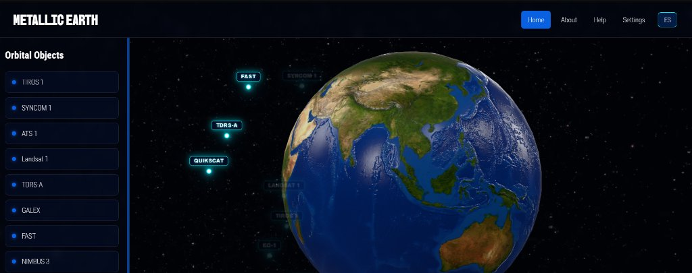
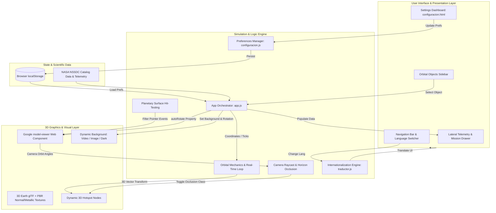

# Metallic Earth



> **"Abandoned but not forgotten"**  
> An interactive 3D web platform to visualize, track, and explore historical and decommissioned satellites orbiting Earth.  
> *Developed for the NASA Space Apps Challenge 2026 — Dominican Republic.*

---

## Table of Contents

- [Overview](#overview)
- [Key Features](#key-features)
- [Featured Orbital Artifacts](#featured-orbital-artifacts)
- [Architecture](#architecture)
  - [System Architecture Diagram](#system-architecture-diagram)
  - [Module Breakdown](#module-breakdown)
  - [Directory Structure](#directory-structure)
- [Mathematical & Orbital Mechanics Engine](#mathematical--orbital-mechanics-engine)
- [Technology Stack](#technology-stack)
- [Getting Started](#getting-started)
- [Configuration & Settings](#configuration--settings)
- [Hackathon Compliance](#hackathon-compliance)
- [License & Acknowledgments](#license--acknowledgments)

---

## Overview

**Metallic Earth** is an educational and scientific web application designed to bring visibility to inactive, historical, and decommissioned satellites that remain in orbit around our planet. Many of these artificial satellites were pioneering technological milestones for humanity—such as the first weather satellite, early geostationary telecommunication nodes, and space telescopes—yet they now orbit silently as historical space artifacts.

Metallic Earth provides an interactive, accessible 3D simulation running directly in any modern web browser without requiring installation, account registration, or external plugins.

---

## Key Features

- **Interactive 3D Earth Globe**: High-fidelity 3D model of planet Earth rendered with physically-based rendering (PBR) textures, atmospheric shaders, and dynamic lighting.
- **Real-Time 3D Orbital Simulation**: Satellites follow mathematically accurate Keplerian circular orbital planes around Earth, accounting for orbital radius, inclination angles, and ascending node rotations.
- **Dynamic Horizon Occlusion**: A custom vector-based occlusion system calculates in real time whether a satellite is in the front or rear hemisphere relative to the user's camera. Satellites passing behind the Earth gracefully fade into translucent markers (15% opacity with soft blur) and disable accidental clicks, restoring full opacity when emerging into view.
- **Surface-Only Raycast Interaction**: Earth rotation and zoom gestures are strictly locked to the 3D planetary geometry via raycasting (`positionAndNormalFromPoint`). Clicking or dragging the empty cosmos does not accidentally spin the globe, providing an intuitive aerospace HUD feel.
- **Lateral Telemetry & Mission Details Panel**: Selecting any satellite in 3D space or via the sidebar menu opens a slide-out glassmorphic telemetry drawer displaying orbital altitude, velocity, period, inclination, mission status, purpose, and direct links to NASA NSSDC scientific records.
- **Bilingual Internationalization (i18n)**: Instant, zero-reload language switching between English and Spanish across all views and technical telemetry.
- **Customizable Simulation Preferences**:
  - **Earth Auto-Rotation**: Toggle dynamic planetary rotation on or off.
  - **Cosmic Backgrounds**: Switch between a looping starfield video, high-resolution still cosmos imagery, or deep space solid dark mode.
  - State persisted across sessions using browser `localStorage`.

---

## Featured Orbital Artifacts

All satellite telemetry and historical summaries are based on verified scientific records from NASA's Master Catalog (NSSDC):

| # | Satellite Name | Launch Date | Purpose / Scientific Domain | Orbit Type |
|---|----------------|-------------|-----------------------------|------------|
| 1 | **TIROS-1** | April 1, 1960 | First successful meteorological satellite (TV cloud imaging) | LEO |
| 2 | **SYNCOM-1** | February 14, 1963 | First geosynchronous communications satellite | GEO |
| 3 | **ATS-1** | December 7, 1966 | Applications technology, full-disk Earth weather & communications | GEO |
| 4 | **Landsat 1** | July 23, 1972 | Earth resources observation and multispectral surface mapping | Sun-synchronous |
| 5 | **TDRS-A (TDRS-1)** | April 4, 1983 | Tracking and Data Relay Satellite for Shuttle & Hubble communications | GEO |
| 6 | **GALEX** | April 28, 2003 | Galaxy Evolution Explorer (Ultraviolet cosmic telescope) | LEO |
| 7 | **FAST** | August 21, 1996 | Fast Auroral Snapshot Explorer (Auroral plasma physics) | Polar Elliptical |
| 8 | **NIMBUS-3** | April 14, 1969 | Advanced atmospheric sounder and infrared weather observation | Sun-synchronous |
| 9 | **QuikSCAT** | June 19, 1999 | SeaWinds scatterometer measuring global ocean surface winds | Sun-synchronous |
| 10 | **EO-1** | November 21, 2000 | Earth Observing-1 (Hyperspectral imaging and technology validation) | Sun-synchronous |

---

## Architecture

Metallic Earth is built upon a modular client-side architecture that decouples 3D scene rendering, dynamic orbital mechanics calculations, localized data storage, and the responsive user interface.

### System Architecture Diagram



### Module Breakdown

1. **Visualization Engine (`index.html`, `<model-viewer>`)**:
   Encapsulates the WebGL runtime via Google's `<model-viewer>` component. Renders the Earth sphere (`tierra/scene.gltf`) with realistic illumination, metallic roughness maps, and shipping/normal details.
2. **Orbital Mechanics & Animation Loop (`app.js`)**:
   Runs a 60 FPS `requestAnimationFrame` loop that computes 3D position vectors $(x, y, z)$ for each satellite based on orbital inclination, ascending node, and smooth angular velocities. Synchronizes with `<model-viewer>` via its programmatic `updateHotspot()` API.
3. **Camera-Relative Horizon Occlusion System (`app.js`)**:
   Samples `modelViewer.getCameraOrbit()` to reconstruct the camera's spherical vector $(\hat{C}_x, \hat{C}_y, \hat{C}_z)$. Computes the projection depth $d_{\text{depth}} = \vec{S} \cdot \hat{C}$ and perpendicular distance to determine if the satellite is physically occluded by Earth's geometry, toggling visual translucency dynamically.
4. **Surface-Constrained Raycasting (`app.js`)**:
   Uses `positionAndNormalFromPoint(x, y)` on pointer and touch events. If the pointer interacts with empty space, events are stopped in the capture phase, preventing unintended scene manipulation.
5. **Internationalization Core (`traductor.js`)**:
   A declarative dictionary-based translation system supporting English and Spanish. Automatically translates document titles, navigation bars, telemetry tables, loading notices, and metadata tags with persistent language preservation.
6. **Configuration Controller (`configuracion.js`)**:
   Manages user settings (Earth auto-rotation and background selection). Applies live changes to the DOM and synchronizes across views using the Web Storage API and storage event listeners.

### Directory Structure

```text
metalic-earth/
├── README.md                   # Project documentation
├── preview.jpg                 # Repository banner preview
└── app/
    ├── index.html              # Main orbital simulation and 3D globe view
    ├── AcercaDe.html           # "About Us" and hackathon project background
    ├── ayuda.html              # User guide, interactive controls, and FAQ
    ├── configuración.html      # System configuration and preferences portal
    ├── configuracion.html      # Configuration alias
    ├── app.js                  # 3D orbital mechanics, occlusion, and telemetry logic
    ├── configuracion.js        # Preferences state manager & storage synchronizer
    ├── traductor.js            # Internationalization (i18n) translation engine
    ├── stilo.css               # Global theme, aerospace glassmorphism, HUD styles
    ├── configuracion.css       # Configuration view styling and toggle switches
    ├── imagenes/               # Satellite mission photography, background stars & logos
    │   ├── ATS-1.jpg
    │   ├── EO.jpg
    │   ├── FAST.jpeg
    │   ├── fondoEstrellas.jpg  # Still cosmos imagery background
    │   ├── GALEX.jpeg
    │   ├── landsat-1.jpg
    │   ├── NIMBUS-3.jpg
    │   ├── preview.jpg
    │   ├── QUICKSCAT.png
    │   ├── SYNCOM-1.png
    │   ├── TDRS-A.png
    │   └── TIROS-1.jpg
    ├── src/
    │   └── VideoFondo3.mp4     # Looping starry space background video
    └── tierra/                 # Earth 3D glTF asset and textures
        ├── scene.gltf          # glTF 3D scene descriptor
        ├── scene.bin           # Geometry buffers and vertex data
        └── textures/           # PBR base color, normal & roughness maps
```

---

## Mathematical & Orbital Mechanics Engine

Each satellite $i$ possesses a tailored set of orbital parameters:
- **Orbital Radius ($r_i$)**: $r_i = R_{\text{Earth}} \times \text{radioMult}_i$
- **Orbital Inclination ($\iota_i$)**: Angle relative to the equatorial plane (in radians).
- **Right Ascension of the Ascending Node ($\Omega_i$)**: Orbital plane orientation along the Y-axis.
- **Mean Motion / Angular Speed ($\omega_i$)**: Calibrated for realistic, majestic rotation ($0.035 - 0.060\text{ rad/s}$).
- **Initial Phase ($\theta_{0, i}$)**: Evenly distributed phase offsets preventing cluster overlap.

### 1. Spatial Orbital Position Vector

For simulation time $t$, the satellite's position in its orbital reference plane is:
$$\theta_i(t) = \theta_{0, i} + \omega_i \cdot t$$
$$x_0 = r_i \cos(\theta_i), \quad z_0 = r_i \sin(\theta_i), \quad y_0 = 0$$

Applying orbital inclination ($\iota_i$):
$$x_1 = x_0$$
$$y_1 = -z_0 \sin(\iota_i)$$
$$z_1 = z_0 \cos(\iota_i)$$

Applying rotation by the Longitude of the Ascending Node ($\Omega_i$):
$$x_{\text{final}} = x_1 \cos(\Omega_i) + z_1 \sin(\Omega_i)$$
$$y_{\text{final}} = y_1$$
$$z_{\text{final}} = -x_1 \sin(\Omega_i) + z_1 \cos(\Omega_i)$$

The resulting coordinates are updated in the `<model-viewer>` scene via:
```javascript
visorTierra.updateHotspot({
    name: slotName,
    position: `${x.toFixed(2)}m ${y.toFixed(2)}m ${z.toFixed(2)}m`
});
```

### 2. Camera-Relative Horizon Occlusion

From camera spherical coordinates $(\phi, \theta)$, the camera direction unit vector $\hat{C}$ is:
$$\hat{C}_x = \sin(\phi) \sin(\theta), \quad \hat{C}_y = \cos(\phi), \quad \hat{C}_z = \sin(\phi) \cos(\theta)$$

Projection depth along the line of sight:
$$d_{\text{depth}} = x_{\text{final}} \hat{C}_x + y_{\text{final}} \hat{C}_y + z_{\text{final}} \hat{C}_z$$

Perpendicular distance from the line-of-sight axis:
$$d_{\perp} = \sqrt{\max\left(0, (x^2 + y^2 + z^2) - d_{\text{depth}}^2\right)}$$

$$\text{Satellite is occluded} \iff d_{\text{depth}} < 0 \quad \text{and} \quad d_{\perp} < R_{\text{Earth}} \times 0.98$$

When occluded, the CSS class `.detras-tierra` transitions opacity to $15\%$ and disables pointer events, preventing accidental selections while behind the planet.

---

## Technology Stack

- **Graphics & 3D**:
  - [Google `<model-viewer>`](https://modelviewer.dev/) (v4.4.0)
  - WebGL / Three.js underlying renderer
  - glTF 2.0 / GLB 3D specifications
- **Frontend Architecture**:
  - Vanilla JavaScript (ES6+ Modules, Async APIs, Event-driven architecture)
  - Semantic HTML5 (Custom Web Components, Accessible ARIA standards)
  - CSS3 (Glassmorphism, CSS Grid, Flexbox, Keyframe Animations)
- **Internationalization**:
  - Custom DOM-based i18n mapping engine (`traductor.js`)
- **Scientific Data Sources**:
  - [NASA NSSDC Master Catalog](https://nssdc.gsfc.nasa.gov/)
  - [NASA Earth Science Data and Information System (ESDIS)](https://www.earthdata.nasa.gov/)

---

## Getting Started

Because Metallic Earth is written in pure vanilla web technologies without complex build steps, you can run it locally with any lightweight HTTP server.

### Prerequisites

- A modern web browser with WebGL support (Google Chrome, Mozilla Firefox, Microsoft Edge, Safari, Brave).

### Running Locally

1. **Clone the repository**:
   ```bash
   git clone https://github.com/robertdavid06/metalic-earth.git
   cd metalic-earth
   ```

2. **Serve the project**:
   Using Python (built-in):
   ```bash
   python -m http.server 8000
   ```
   Or using Node.js `npx serve`:
   ```bash
   npx serve .
   ```
   Or open with VS Code's **Live Server** extension.

3. **Open in browser**:
   Navigate to:
   ```text
   http://localhost:8000/app/index.html
   ```

---

## Configuration & Settings

Access the **Settings** view (`configuración.html`) via the header navigation to personalize:

1. **Language Selection**: Switch between English (`EN`) and Spanish (`ES`).
2. **Earth Auto-Rotation**: Enable or disable dynamic planetary spinning when idle.
3. **Space Background**:
   - **Starry Video**: Dynamic looping video of deep space.
   - **Cosmos Still Image**: High-resolution still cosmos wallpaper.
   - **Solid Dark Space**: Minimalist, deep space dark background.

---

## Hackathon Compliance

Metallic Earth meets all technical and design requirements established for the **NASA Space Apps Challenge**:
- [x] **Universal Web Access**: Accessible from any modern browser with zero installation.
- [x] **No Registration Required**: Immediate, open interactive exploration.
- [x] **At Least 10 Scientific Artifacts**: 10 historical satellites modeled with real orbital telemetry.
- [x] **NASA-Originating Scientific Data**: All spacecraft details, launch dates, instruments, and status verified through NASA NSSDC records.
- [x] **Dynamic 3D Interaction**: Unrestricted camera orbit, smooth zoom, and object selection.

---

## License & Acknowledgments

- **Challenge**: NASA Space Apps Challenge 2026.
- **Creator**: Robert David Zorrilla Taveras & Team.
- **Data & Imagery**: Scientific mission records courtesy of NASA / NSSDC.
- **3D Assets**: Earth 3D model licensed under Creative Commons Attribution.
